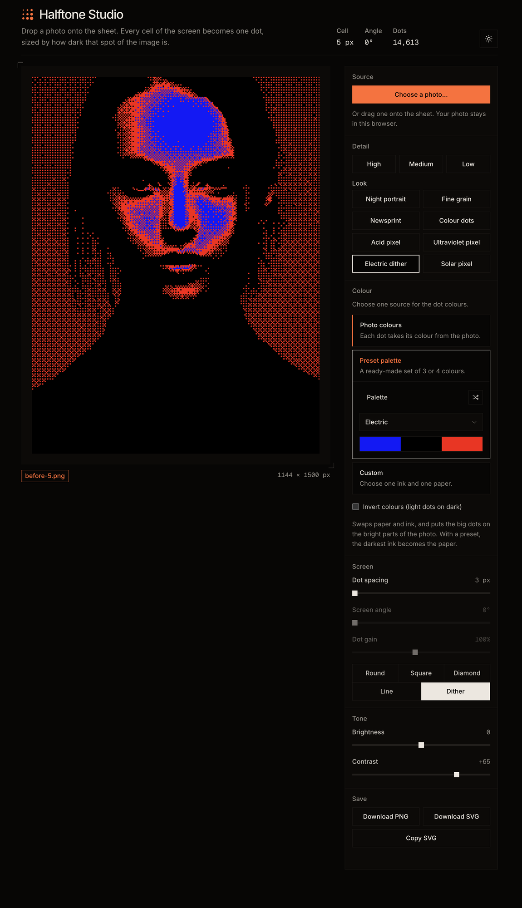
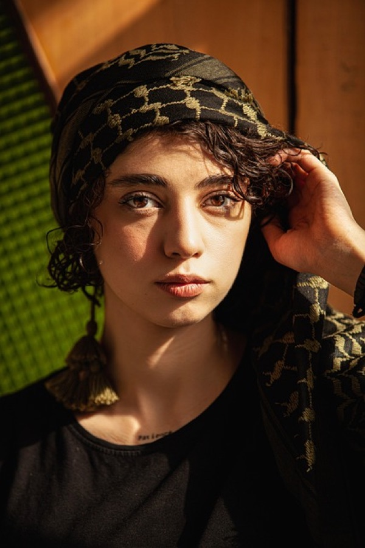
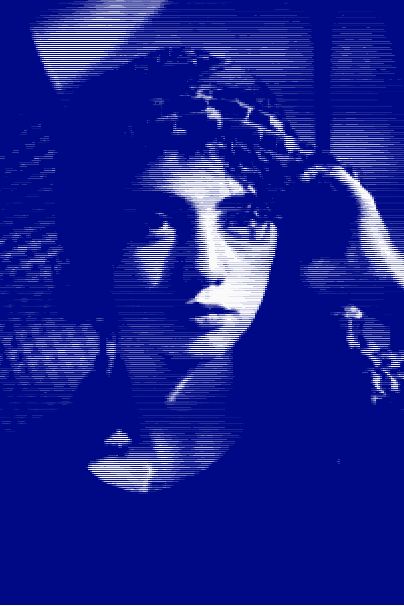
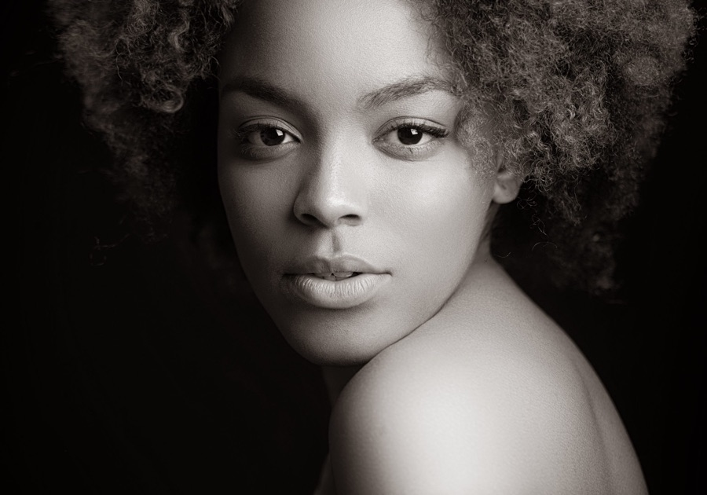
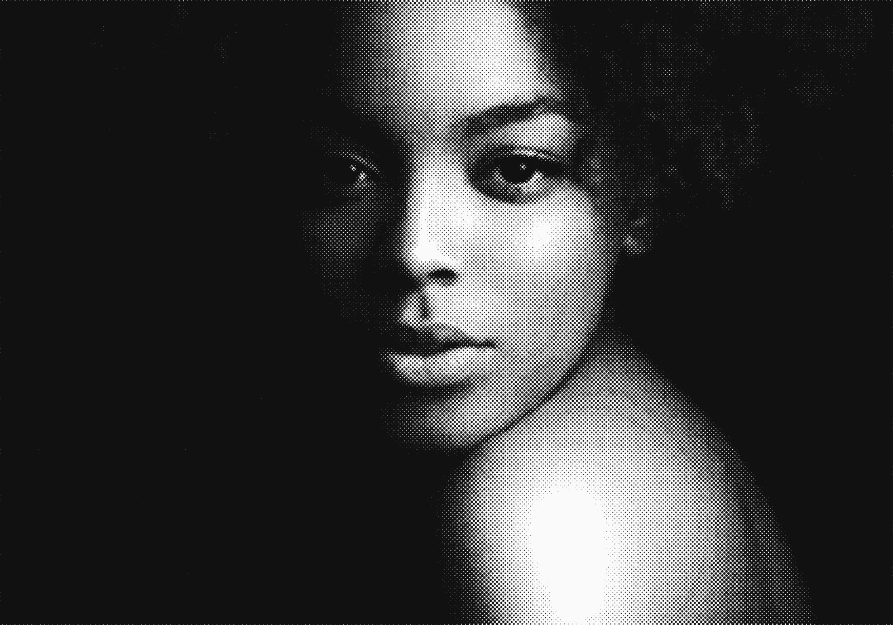
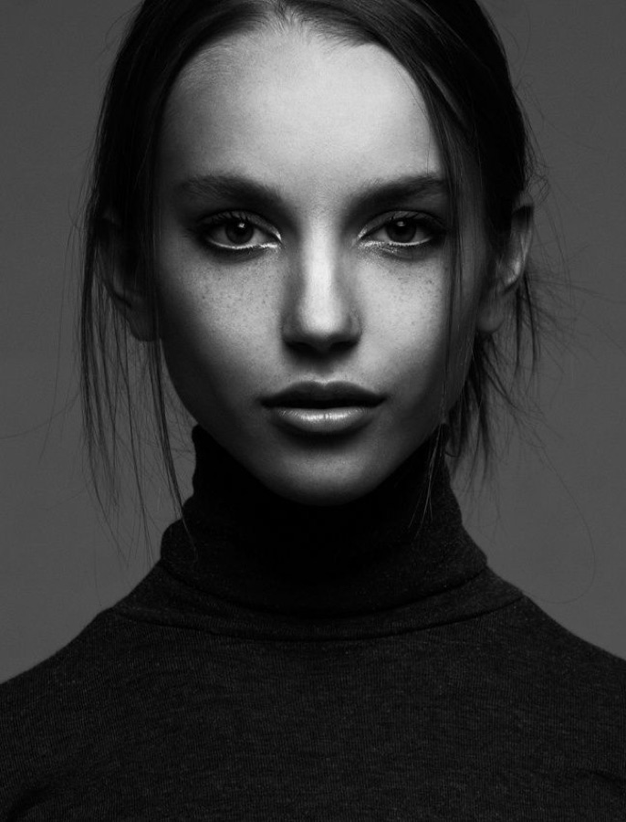
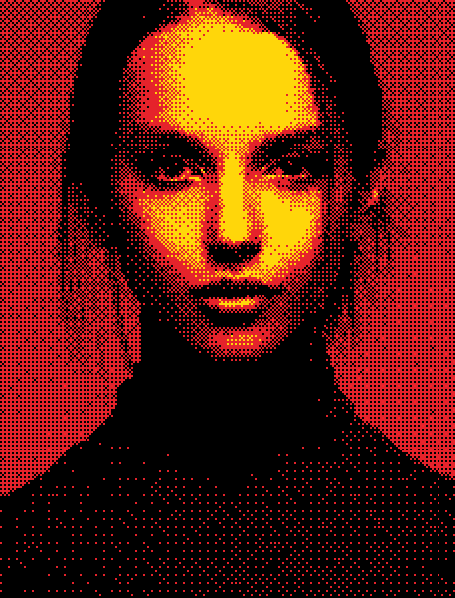

# [Halftone Studio](https://makehalftone.pages.dev/)

Create halftone and dither images from your photos in the browser. Drop a photo, pick a look, and save the result as PNG or SVG.

Your photo is processed on your device and is never uploaded. The site uses [GoatCounter](https://www.goatcounter.com/) for anonymous, cookie-free visit and download counts; no photo data is sent.

## Examples

| Before | After |
| --- | --- |
|  |  |
|  |  |
|  |  |

## Use it

Open `index.html` in a browser. There is no build step and nothing to install.

1. Choose, drop or paste a photo.
2. Pick a detail level and a look, or tune the controls yourself.
3. Choose a colour source: photo colours, a preset palette, or a custom ink and paper.
4. Download the PNG or SVG, or copy the SVG.

The page follows your system's light or dark setting. Use the sun/moon button in the header to switch; your choice is remembered.

## Controls

- **Detail:** High, Medium and Low presets, plus looks such as Night portrait, Newsprint and Electric dither.
- **Colour:** photo colours, one of 29 preset palettes, or a custom ink and paper. Invert swaps them.
- **Screen:** dot spacing, screen angle, dot gain and dot shape (round, square, diamond, line, dither).
- **Tone:** brightness and contrast.
